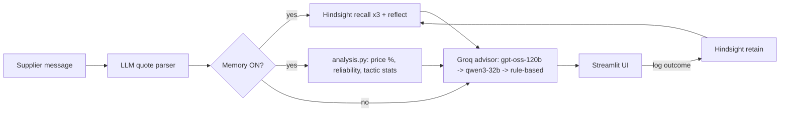

# 🧠 Vendor Memory & Negotiation Agent
*Hack with Bangalore 4.0 · AI Agents That Learn Using Hindsight*

An AI agent for procurement managers that **remembers every supplier quote, discount, delivery and negotiation outcome**,
and uses that memory to spot price spikes and recommend the tactic that has actually worked with *that* supplier.

## Problem
Buyers at mid-size Indian e-commerce and packaging companies get quotes over email and WhatsApp. History lives in
inboxes and spreadsheets, so they accept worse prices and repeat negotiation tactics that already failed.

## Solution
When a new quote arrives the agent: parses it, **recalls** the supplier's history from Hindsight, **analyzes** exact numbers
(price change, reliability), returns negotiation points, a suggested tactic and a draft counter-offer email, then
**learns** from the logged outcome. A **Memory ON/OFF** switch and a Before/After tab make the difference obvious.

## Architecture


## How Hindsight Memory Is Used
| Concern | Implementation |
|---|---|
| **Banks** | One bank per supplier (`vendor-sup-001` ... via `schema.bank_id_for`), created with a procurement-specific *mission* and disposition. |
| **Retain** | Every quote, discount, delivery and negotiation outcome is retained as a short factual sentence (`schema.*_to_memory_text`) with its **real historical timestamp**, a context label and a stable `document_id` (re-loading upserts, no duplicates). ~130 memories at seed time. |
| **Recall** | Before advising, 3 targeted queries run in parallel: price and discounts for the item; late/damaged deliveries; tactics that worked or failed. Results are de-duplicated, sorted by date, shown verbatim in the UI and passed to the LLM. |
| **Reflect** | `reflect("What negotiation approach has worked best with this supplier?")` gives a synthesized strategy insight that anchors the advice. |
| **Feedback loop** | `log_outcome()` retains the new quote, the outcome and any resulting discount, so the next quote from that supplier is smarter (the learning curve). |
| **Before / After** | Memory OFF sends the LLM only the quote (generic advice). Memory ON adds recalled memories, reflection and computed analysis, and the prompt forbids inventing facts. |

Numbers (price %, reliability score) are computed in plain Python from a structured ledger so they are exact; Hindsight supplies the
memory the LLM reasons over.

## Setup
1. `python -m venv .venv && source .venv/bin/activate` and `pip install -r requirements.txt`
2. **Hindsight Cloud:** register at https://ui.hindsight.vectorize.io, then in **Billing** enter promo code **MEMHACK99** ($50 credit). Create an API key.
   *Or* run open source locally: `docker run -p 8888:8888 -p 9999:9999 ghcr.io/vectorize-io/hindsight:latest` (check the Hindsight docs for the LLM env vars it needs) and use `http://localhost:8888` with no key.
3. **Groq:** free key at https://groq.com/.
4. `cp .env.example .env` and fill `HINDSIGHT_BASE_URL`, `HINDSIGHT_API_KEY`, `GROQ_API_KEY`.
5. **Band AI desktop (hackathon requirement, manual step):** download from https://www.band.ai and install on the team machines.

## Run
```bash
python scripts/generate_data.py       # reproducible synthetic data (already committed in data/)
python memory/load_seed_data.py       # loads history into Hindsight (idempotent; --force to reload)
streamlit run app/streamlit_app.py
pytest -q                             # analysis tests
```
Follow `demo/DEMO_SCRIPT.md` for the 3-minute story.

## Accounts / login
The app starts with a **Log in / Create account** page. Passwords are stored as salted PBKDF2 hashes in a local SQLite file
(`data/users.db`), with a 60-second lockout after 5 wrong attempts. All users share one supplier memory (a team workspace);
each logged outcome records who logged it. Set `AUTH_REQUIRED=0` to skip login locally.
On hosts with an ephemeral disk (Streamlit Community Cloud) accounts are lost on restart; swap `app/auth.py` for Supabase/Auth0 for permanent accounts.

## Live demo
_Add your Streamlit Cloud link here: https://vendor-memory-agent-1.streamlit.app/

## Project structure
```
data/ suppliers, quotes, discounts, deliveries, outcomes, demo_quotes (JSON)
memory/ hindsight_store.py (retain/recall/reflect), load_seed_data.py
agent/ analysis.py, llm.py, prompts.py, negotiation_agent.py, ledger.py (structured records)
app/streamlit_app.py   scripts/generate_data.py   tests/test_analysis.py   demo/DEMO_SCRIPT.md
schema.py  (single source of truth for models)
```

## Reliability design
Groq: `openai/gpt-oss-120b` then `qwen/qwen3-32b`; JSON mode with fallback to plain mode; 3 JSON attempts with a stricter reminder;
then a plain-text prompt; then a deterministic rule-based recommendation. Hindsight calls retry twice and degrade to a visible warning.

## Supplier personalities in the data
QuickCart (cheap, late 40%, delivery-penalty clause works) · Prime Industrial (premium, reliable, long-term contracts work) ·
VolumeMax (volume commitments give 7 to 10%) · Deccan Wholesale (frequent price rises, early payment gives 3 to 5%).

## Screenshots
_Add: Recommendation tab, memory panel, Before/After tab, price chart._

## Limitations
- Synthetic data; one product category (packaging); single user.
- Runtime ledger is a local JSON file; Hindsight memories are not deleted by "Reset demo".
- Recalled memory dates depend on the fields the Hindsight server returns.
- Hindsight client/API details were checked against the docs but should be confirmed against your installed version.

## Future work
Email/WhatsApp inbox ingestion, multi-category sourcing, PO/invoice matching, approval workflows, shared team memory.
